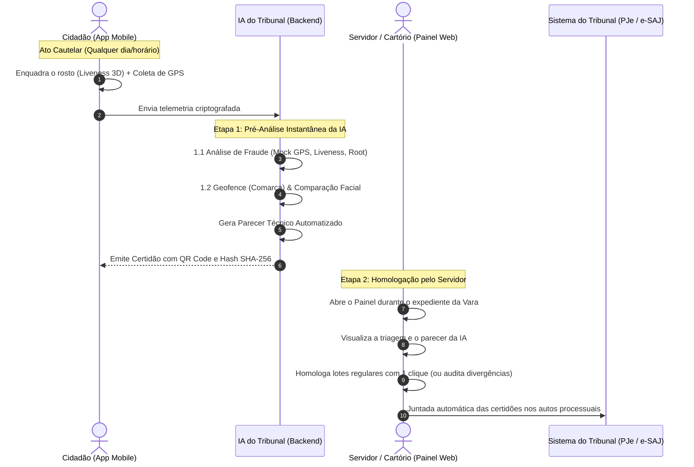

# CompareceJus • Apresentação Periódica Digital
> **Modernização do Comparecimento em Juízo (Medida Cautelar — Art. 319, I, do Código de Processo Penal)**

---

## ⚖️ O Problema Real nos Fóruns vs. A Solução CompareceJus

### 🔴 O Cenário Atual (Ineficiência e Custos)
Atualmente, réus em cumprimento de medidas cautelares diversas da prisão (**Art. 319, I, CPP**), liberdade provisória concedida em Audiência de Custódia ou ANPP (Acordo de Não Persecução Penal) são obrigados a comparecer **mensalmente e no horário do expediente forense** ao fórum apenas para **assinar um livro físico de presenças**:
* **Para a Secretaria da Vara / Servidores Públicos:** Filas intermináveis no balcão de atendimento, interrupção contínua dos trabalhos cartorários, conferência manual de documentos físicos e risco constante de extravio de folhas.
* **Para o Cidadão:** Gastos recorrentes com passagens de transporte público, perda do dia de trabalho formal ou informal e constrangimento desnecessário de deslocamento.

### 🟢 A Solução CompareceJus (Transformação Digital)
O **CompareceJus** substitui a assinatura de papel por uma **apresentação digital auditável de 15 segundos**, realizada diretamente pelo smartphone do intimado, com validação de raio territorial (**Geofencing**), prova de vida biométrica facial (**Liveness 3D**) e emissão instantânea de **Certidão com Fé Pública**:
* **Zero filas no balcão do fórum:** Mais de 94% dos comparecimentos regulares são triados com precisão pela IA e homologados pelo servidor em poucos segundos.
* **Modelo Operacional Assíncrono:** O cidadão não depende de estar na frente de um atendente ou fazer chamada de vídeo em tempo real; ele cumpre o ato em qualquer dia e horário (inclusive finais de semana e noites), e o servidor homologa no expediente do cartório.
* **Gestão por Exceção:** A secretaria da vara só se debruça sobre os casos que apresentarem alertas objetivos de inconformidade (ex: fora da comarca permitida, tentativa de GPS falso ou biometria facial divergente).
* **Integridade Jurídica e Privacidade:** Sem vigilância contínua ou invasiva (não substitui nem atua como tornozeleira eletrônica); a verificação ocorre estritamente no momento do ato mensal, em conformidade com a **LGPD** e as **Resoluções CNJ nº 288/2019 e nº 332/2020**.

---

## 🔄 Fluxo de Funcionamento Assíncrono em 2 Etapas

O sistema adota a governança de inteligência artificial com supervisão humana (**Human-in-the-Loop**), dispensando atendimento síncrono:

---

## 📱 1. O App do Cidadão (Visão Mobile)

Desenvolvido com foco em **extrema simplicidade, clareza visual e acessibilidade** para cidadãos de qualquer nível de instrução:

* **🏠 Aba Início (Dashboard Limpo):**
  - **Status imediato:** Badge visual claro (`Outubro / 2026 • Pendente` ou `Homologado`) e contagem regressiva de dias para o vencimento do prazo.
  - **Ação principal única:** Botão em destaque *"Realizar Comparecimento"* que conduz diretamente ao fluxo de validação.
  - **Resumo do Processo:** Número unificado CNJ do processo com botão de **cópia em 1 toque**.
  - **Histórico Interativo:** Clique nos meses anteriores (*Setembro*, *Agosto*) para visualizar e baixar a certidão arquivada.
  - **Módulo Nativo de Justificativa Judicial:** Botão *"Precisa justificar ausência?"* para quem estiver hospitalizado ou impossibilitado de comparecer, permitindo anexar atestado e gerar protocolo oficial imediato (`JUST-2026-SP-XXXXX`).

* **📷 Aba de Identificação Facial (Biometria & GPS):**
  - **Visor Oval Inteligente:** Espelhamento natural de selfie (sem distorções de ângulo), com retículo que muda de cor de acordo com o enquadramento.
  - **Controles de Câmera Funcionais:** Alternância instantânea de modo espelho e alternância para câmera frontal/traseira.
  - **Prova de Vida Ativa (Liveness 3D):** O sistema orienta o cidadão (*"Pisque devagar..."*), prevenindo fotos impressas ou vídeos pré-gravados em telas de terceiros.
  - **Telemetria de Comarca (GPS):** Chip flutuante interativo que comprova se o réu está dentro dos limites da Comarca autorizada pelo Juízo criminal.

* **🧾 Tela de Comprovante Oficial (Certidão Digital):**
  - Estilo de recibo bancário limpo e institucional.
  - Dados tabulares: data, hora de Brasília, comarca, protocolo e Hash criptográfico SHA-256.
  - **QR Code em alta definição:** Permite que qualquer autoridade policial ou oficial de justiça aponte a câmera do celular para atestar a autenticidade diretamente no portal do Tribunal.
  - Botão de **Compartilhar no WhatsApp** e **Baixar PDF Oficial**.

---

## 💻 2. O Painel da Vara Criminal (Visão do Servidor / Desktop)

Desenvolvido para eliminar o trabalho manual repetitivo da secretaria da vara criminal e viabilizar a tomada de decisão com segurança jurídica:

* **📊 Métricas de Triagem Inteligente (Gestão por Exceção):**
  - **Total de Intimados:** Volume de réus com cautelar ativa no mês.
  - **Validados Automaticamente (94.4%):** Réus que cumpriram perfeitamente dentro da comarca e com biometria confirmada pela IA.
  - **Alertas para Auditoria:** Casos isolados que requerem despacho humano (ex: réu fora do raio territorial ou divergência biométrica).
* **🧠 Etapa 1: Laudo de Pré-Análise da IA do Tribunal:**
  - **1.1 Índice de Fraude / Spoofing:** Detecção matemática de emuladores de GPS falso (*Mock Location*), injeção de vídeo ou fotos estáticas.
  - **1.2 Geofence & Endereço:** Validação das coordenadas geográficas contra o polígono territorial da Comarca.
  - **Parecer Técnico da IA:** Recomendações claras para orientar o escrevente (*"Apresentação regular. Sugerida homologação de plano..."* ou *"🚨 Fraude de telemetria interceptada..."*).
* **⚖️ Etapa 2: Homologação pelo Servidor (Decisão Humana Final):**
  - **Zero Atendimento Simultâneo:** O servidor não precisa estar conectado ao mesmo tempo em que o réu realiza a validação.
  - Botão **"Homologar Apresentação (Aprovar Parecer da IA)"** com registro de assinatura funcional no histórico.
  - Remessa direta de conclusão com alertas fundamentados ao Juiz de Direito nos casos de inconformidade grave.
* **🔍 Dossiê Comparativo de Auditoria:**
  - Painel lateral interativo que coloca a **foto oficial cadastrada na Audiência de Custódia** lado a lado com a **foto real tirada no celular**.
  - Exibição de mapa interativo com o ponto exato da captura e coordenadas auditáveis.
* **⚡ Protocolo em Lote no PJe / SEEU:**
  - Botão *"Juntar Certidões nos Autos em Lote"* que assina digitalmente e protocola centenas de certidões nos processos com apenas 1 clique.

---

## 🥊 O que o CompareceJus traz de Inovação frente ao SAREF (CNJ)?

| Aspecto Analisado | SAREF (CNJ / TJDFT) | CompareceJus |
| :--- | :--- | :--- |
| **Público-Alvo Principal** | Foco na Vara de Execução Penal (SEEU / condenados definitivos). | **Varas Criminais Comuns (Art. 319, I, CPP)** e réus em liberdade provisória da Custódia, onde reside o maior gargalo físico de balcão. |
| **Disponibilização da Certidão** | Envio por e-mail em até 48 horas úteis. | **Emissão Imediata em 3 segundos** com QR Code e Hash SHA-256 no celular do réu. |
| **Tratamento de Inconsistências** | Bloqueio automático após 3 tentativas inválidas, obrigando ida ao balcão. | **Dossiê de Auditoria:** foto e telemetria vão para a fila do escrevente, que decide com 1 clique sem obrigar o cidadão a faltar ao trabalho. |
| **Módulo de Justificativa** | Ausente; exige peticionamento por advogado ou deslocamento físico. | **Protocolo Nativo com Anexo de Atestado Médico** e geração de recibo com fé pública. |
| **Modelo de Triagem** | Validação centralizada e rígida. | **IA Pré-analítica com Homologação Assíncrona** conforme Resolução CNJ nº 332/2020. |

---

## 🏛️ Conformidade Legal e Regulatória

| Norma / Lei | Aplicação no CompareceJus |
| :--- | :--- |
| **Art. 319, I e IV, do CPP** | Cumprimento estrito da medida cautelar de comparecimento periódico e proibição de ausentar-se da comarca. |
| **Resolução CNJ nº 332/2020** | Governança e ética no uso de Inteligência Artificial no Judiciário (*Human-in-the-Loop* com homologação humana obrigatória). |
| **Resolução CNJ nº 288/2019** | Política institucional do Poder Judiciário para aplicação e fiscalização de alternativas penais sem estigmatização. |
| **Lei nº 11.419/2006** | Informatização do processo judicial brasileiro e plena validade jurídica dos atos praticados por meio eletrônico. |
| **LGPD (Lei nº 13.709/2018)** | Princípio da necessidade e minimização de dados: **coleta pontual no momento do comparecimento** (sem rastreamento contínuo). |
| **Fé Pública (ICP-Brasil)** | Hash criptográfico SHA-256 e carimbo de tempo garantindo autenticidade, integridade e não-repúdio do ato. |

---

### Autoria & Propriedade Intelectual
* **Projeto:** CompareceJus
* **Autor:** Arthur Macedo
* **Finalidade:** Modernização tecnológica do Poder Judiciário brasileiro.
