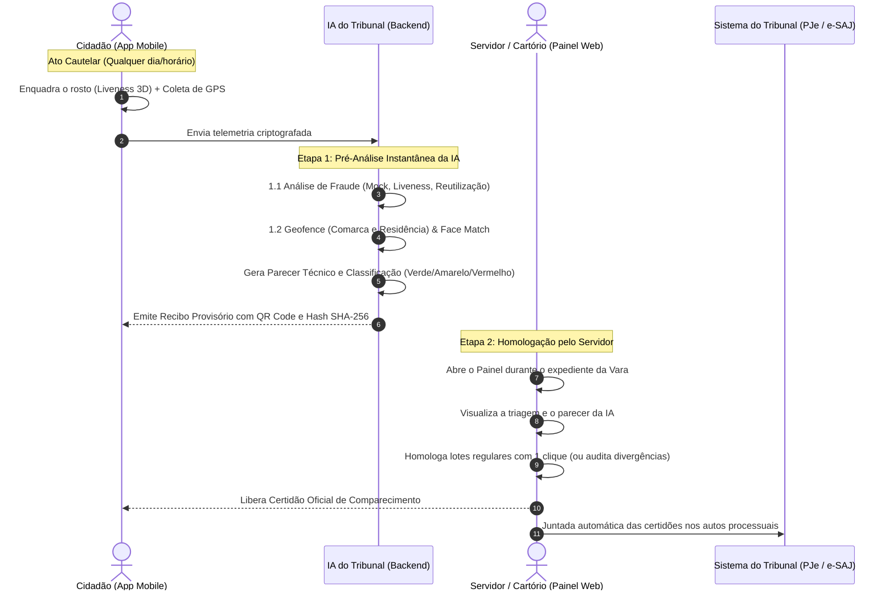

# CompareceJus • Apresentação Periódica Digital
> **Modernização do Comparecimento em Juízo (Medida Cautelar — Art. 319, I, do Código de Processo Penal)**


---

## ⚖️ O Problema Real nos Fóruns vs. A Solução CompareceJus

### 🔴 O Cenário Atual (Gargalo Físico fora do SEEU)
Atualmente, réus em cumprimento de medidas cautelares diversas da prisão (**Art. 319, I, CPP**), liberdade provisória concedida em Audiência de Custódia ou ANPP (Acordo de Não Persecução Penal) são obrigados a comparecer **mensalmente e no horário do expediente forense** ao fórum apenas para **assinar um livro físico de presenças**:
* **O Ponto Cego do Judiciário:** O **SAREF** (CNJ/TJDFT) atende com excelência a Execução Penal conectada ao SEEU. Todavia, os processos de conhecimento (que tramitam no **PJe, e-SAJ e eproc**) **não estão no SEEU** e continuam 100% dependentes do livro de papel no balcão.
* **Sobrecarga de Servidores:** Filas contínuas de balcão, interrupção das atividades dos escreventes e risco de extravio de folhas.
* **Prejuízo ao Cidadão:** Gastos recorrentes com transporte coletivo e perda de dias de trabalho formal ou informal.

### 🟢 A Solução CompareceJus (Transformação Digital)
O **CompareceJus** substitui a assinatura de papel por uma **apresentação digital auditável**, realizada diretamente pelo smartphone do intimado, com validação de raio territorial (**Geofencing**), prova de vida biométrica facial (**Liveness 3D**) e emissão de **Certidão com Fé Pública**:
* **Modelo Operacional Assíncrono:** O cidadão cumpre o ato em qualquer dia e horário dentro do ciclo mensal; o servidor homologa no expediente do cartório, sem atendimento simultâneo.
* **Triagem Semafórica (Gestão por Exceção):** A IA classifica os casos em 🟢 Verdes (regulares para homologação em lote), 🟡 Amarelos (pontos de atenção territoriais) e 🔴 Vermelhos (fora da comarca ou suspeita de fraude), desonerando até 90% do tempo de atendimento.
* **Supervisão Humana Obrigatória (*Human-in-the-Loop*):** Em estrita conformidade com a **Resolução CNJ nº 615/2025**, a IA atua exclusivamente na pré-análise; a decisão jurídica é sempre do servidor ou magistrado.
* **Privacidade Estrita (LGPD):** Não atua como tornozeleira eletrônica. A localização só é lida nos 30 segundos do ato mensal, sem qualquer monitoramento contínuo de rotina.

---

## 🔄 Fluxo de Funcionamento Assíncrono em 2 Etapas



---

## 📁 Documentação Oficial para Apresentação ao CNJ

Toda a documentação técnica, jurídica e executiva para apresentação perante o Conselho Nacional de Justiça encontra-se organizada na pasta [`docs/`](docs/README.md):

* **[01. Resumo Executivo (1 Página)](docs/01_resumo_executivo.md)** — Resumo conciso de problema, solução, diferenciais e modelos de adoção.
* **[02. Roteiro de Apresentação em Slides (15 Minutos)](docs/02_apresentacao_cnj.md)** — Roteiro completo de slides com falas e cálculo de economia de horas públicas.
* **[03. Roteiro de Demonstração ao Vivo](docs/03_roteiro_demonstracao.md)** — Passo a passo prático, casos de teste e respostas para perguntas técnicas difíceis.
* **[04. Regras de Negócio e Matriz de Riscos da IA](docs/04_regras_de_negocio.md)** — Máquina de estados e os 19 sinais algorítmicos do motor pré-analítico.
* **[05. Comparativo com o SAREF e "SAREF Cautelar"](docs/05_comparativo_saref.md)** — Estudo aprofundado de escopo e proposta de integração à PDPJ-Br.
* **[06. Arquitetura de Produção](docs/06_arquitetura_producao.md)** — Especificações de app nativo (Play Integrity/App Attest), barramento MNI e fases de implantação.
* **[07. Conformidade com a LGPD e Ética de IA](docs/07_lgpd_e_etica_ia.md)** — Fundamentos legais, princípio da não-vigilância contínua e mitigação de vieses.
* **[08. Próximos Passos: Registro.br, INPI e Ofícios ao CNJ](docs/08_proximos_passos_registro.md)** — Checklist para registro de domínio, marca, software (SHA-512) e minutas de e-mail e pedido de audiência.

---

## 💻 Como Executar o Protótipo Localmente

O protótipo foi construído em arquitetura autossuficiente (Node.js nativo sem dependências externas adicionais):

1. **Iniciar o Servidor:**
   ```bash
   node server.js
   ```
2. **Acessar os Ambientes:**
   - **Hub Central de Demonstração (Recomendado):** `http://localhost:3000`
   - **Painel da Secretaria da Vara:** `http://localhost:3000/painel`
   - **Aplicativo do Cidadão:** `http://localhost:3000/app`
   - **Validador Público de Fé Pública (QR Code):** `http://localhost:3000/verificar`

---

### Autoria & Propriedade Intelectual
* **Projeto:** CompareceJus
* **Autor e Desenvolvedor:** Arthur Macedo
* **Finalidade Institucional:** Modernização tecnológica e desoneração do Poder Judiciário brasileiro.
