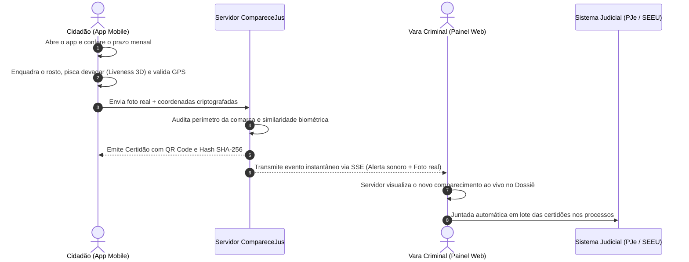

# CompareceJus • Apresentação Periódica Digital
> **Modernização do Comparecimento em Juízo (Medida Cautelar — Art. 319, I, do Código de Processo Penal)**

---

## ⚖️ O Problema Real nos Fóruns vs. A Solução CompareceJus

### 🔴 O Cenário Atual (Ineficiência e Custos)
Atualmente, réus em cumprimento de medidas cautelares diversas da prisão (**Art. 319, I, CPP**), livramento condicional ou ANPP (Acordo de Não Persecução Penal) são obrigados a comparecer **mensalmente e em horário de expediente** ao fórum apenas para **assinar um livro físico de presenças**:
* **Para a Vara / Servidores Públicos:** Filas intermináveis no balcão de atendimento, interrupção contínua dos trabalhos cartorários, conferência manual de documentos e risco de extravio de folhas físicas.
* **Para o Cidadão:** Gastos recorrentes com passagens de ônibus, perda de dia de trabalho formal/informal e constrangimento de deslocamento.

### 🟢 A Solução CompareceJus (Transformação Digital)
O **CompareceJus** substitui a assinatura de papel por uma **apresentação digital auditável de 15 segundos**, realizada diretamente pelo smartphone do intimado, com validação de raio territorial (**Geofencing**), prova de vida biométrica facial (**Liveness 3D**) e emissão instantânea de **Certidão com Fé Pública**:
* **Zero filas no fórum:** 94% dos comparecimentos regulares são validados e protocolados automaticamente.
* **Gestão por Exceção:** A secretaria da vara só analisa os casos que apresentarem alertas de inconformidade (ex: fora da comarca ou biometria duvidosa).
* **Integridade Jurídica:** Sem vigilância contínua ou invasiva (não é tornozeleira eletrônica); a verificação ocorre estritamente no momento do ato mensal, em conformidade com a **LGPD** e com a **Resolução CNJ nº 288/2019**.

---

## 🔄 Fluxo de Funcionamento em Tempo Real

---

## 📱 1. O App do Cidadão (Visão Mobile)

Desenvolvido com foco em **extrema simplicidade e acessibilidade** para cidadãos de qualquer nível de instrução:

* **🏠 Aba Início (Dashboard Limpo):**
  - **Status imediato:** Badge visual claro (`Outubro / 2026 • Pendente` ou `Homologado`) e contagem regressiva de dias.
  - **Ação principal única:** Botão em destaque *"Realizar Comparecimento"* que abre o fluxo de validação.
  - **Resumo do Processo:** Número do processo em 2 linhas com botão de **cópia em 1 toque**.
  - **Histórico Interativo:** Clique nos meses anteriores (*Setembro*, *Agosto*) para visualizar e baixar a certidão arquivada.
  - **Fluxo de Justificativa Judicial:** Botão *"Precisa justificar ausência?"* para quem estiver internado ou impossibilitado de comparecer, permitindo anexar atestado e gerar protocolo oficial imediato (`JUST-2026-SP-XXXXX`).

* **📷 Aba de Identificação Facial (Biometria & GPS):**
  - **Visor Oval Inteligente:** Espelhamento natural de selfie (sem distorções de ângulo), com retículo que muda de cor de acordo com o enquadramento.
  - **Botões de Controle de Câmera:** Permite ligar/desligar o modo espelho ou alternar para a câmera traseira.
  - **Prova de Vida Ativa (Liveness 3D):** O sistema orienta o cidadão (*"Pisque devagar..."*), impedindo o uso de fotos estáticas ou vídeos pré-gravados de terceiros.
  - **Telemetria de Comarca (GPS):** Chip flutuante interativo que comprova se o réu está dentro dos limites da Comarca autorizada pelo Juízo.

* **🧾 Tela de Comprovante Oficial (Certidão Digital):**
  - Estilo de recibo bancário limpo e institucional.
  - Dados tabulares: data, hora de Brasília, comarca, protocolo e Hash criptográfico SHA-256.
  - **QR Code em alta definição:** Permite que qualquer policial ou oficial de justiça aponte a câmera do celular para verificar a validade no portal do Tribunal.
  - Botão de **Compartilhar no WhatsApp** e **Baixar PDF Oficial**.

---

## 💻 2. O Painel da Vara Criminal (Visão do Servidor / Desktop)

Desenvolvido para eliminar o trabalho manual repetitivo da secretaria da vara criminal:

* **📊 Métricas de Triagem Inteligente (Gestão por Exceção):**
  - **Total de Intimados:** Volume de réus com cautelar ativa no mês.
  - **Validados Automaticamente (94.4%):** Réus que cumpriram perfeitamente dentro da comarca e com biometria confirmada.
  - **Alertas para Auditoria:** Casos isolados que requerem despacho humano (ex: réu que tentou validar em outra cidade ou usou aplicativo de GPS falso).
* **⚡ Sincronização ao Vivo (Server-Sent Events):**
  - Quando o cidadão envia a selfie pelo celular, o painel do computador emite um **aviso sonoro judicial**, exibe notificação instantânea e insere a linha com badge pulsante **`● AO VIVO • CELULAR`**.
* **🔍 Dossiê Comparativo de Auditoria:**
  - Painel lateral interativo que coloca a **foto oficial cadastrada no Tribunal** lado a lado com a **foto real que o cidadão acabou de tirar no celular**.
  - Exibição de mapa com o ponto exato da captura e status do detector **anti-mocking** (anti-emulador de GPS).
* **⚖️ Protocolo em Lote no PJe / SEEU:**
  - Botão *"Juntar Certidões nos Autos em Lote"* que assina digitalmente e protocola centenas de certidões nos processos com apenas 1 clique, emitindo recibo geral unificado.
    
---

## 🏛️ Conformidade Legal e Regulatória

| Norma / Lei | Aplicação no CompareceJus |
| :--- | :--- |
| **Art. 319, I, do CPP** | Cumprimento estrito da medida cautelar de comparecimento periódico em juízo. |
| **Lei nº 11.419/2006** | Informatização do processo judicial e plena validade de atos por meio eletrônico. |
| **Resolução CNJ nº 288/2019** | Incentivo à modernização e despenalização de procedimentos burocráticos em alternativas penais. |
| **LGPD (Lei nº 13.709/2018)** | Princípio da necessidade e finalidade: **coleta pontual no momento do ato** (sem monitoramento 24h contínuo). |
| **Fé Pública (ICP-Brasil)** | Hash SHA-256 e carimbo de tempo do Observatório Nacional garantindo autenticidade e não-repúdio. |

---

### Autoria & Propriedade Intelectual
* **Projeto:** CompareceJus
* **Autor:** Arthur Macedo
* **Finalidade:** Modernização tecnológica do Poder Judiciário brasileiro.
