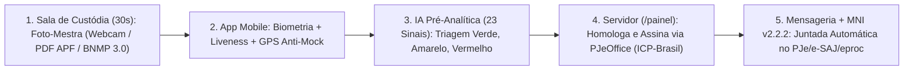

# Roteiro de Apresentação Institucional ao CNJ — DMF e DTI (15 minutos)

> [!NOTE]
> Cada slide traz o **conteúdo visual** e a **fala técnica sugerida**, já alinhada à linguagem da **PDPJ-Br (Res. CNJ 335/2020)**, do **MNI v2.2.2**, da **Lei nº 11.419/2006 (ICP-Brasil)** e das **Resoluções CNJ nº 288/2019 e nº 615/2025**.

Tempo sugerido: 10 min de exposição executiva + 5 min de demonstração ao vivo do protótipo v2.0 (ver [03_roteiro_demonstracao.md](03_roteiro_demonstracao.md)).

---

## Slide 1: Abertura — O Módulo Cautelar da PDPJ-Br (45 s)

**Tela:**
- **CompareceJus v2.0:** Microsserviço Nativo PDPJ-Br para Apresentação Periódica Cautelar (Art. 319, I e IV, do CPP)
- Interoperabilidade nativa **MNI v2.2.2** (PJe, e-SAJ, eproc) + Assinatura **PJeOffice / ICP-Brasil**

**Fala:**
> "Bom dia. Apresento o CompareceJus v2.0, concebido estritamente como um microsserviço nativo da nuvem PDPJ-Br — um 'Módulo Cautelar' para estender a transformação digital que o SAREF trouxe na execução penal para os processos de conhecimento que tramitam no PJe, no e-SAJ e no eproc: liberdade provisória oriunda de audiência de custódia, medidas cautelares diversas da prisão, ANPP e suspensão condicional do processo."

---

## Slide 2: O Gargalo Atual nas Varas Criminais (1 min)

**Tela:**
- **Escopo Legal:** Art. 319, I e IV, CPP · Art. 28-A CPP (ANPP) · Art. 89 da Lei 9.099/95
- **Realidade operacional fora do SEEU:** Fila mensal no balcão → assinatura em livro de papel → certidão manual no PJe/e-SAJ/eproc
- **Fragilidade probatória:** Livro físico não atesta permanência na comarca nem possui carimbo de tempo auditável

**Fala:**
> "O SAREF foi um marco para a Vara de Execuções Penais integrada ao SEEU. Porém, quem recebe liberdade provisória na audiência de custódia responde ao processo no PJe, e-SAJ ou eproc. Na maioria das comarcas brasileiras, esse cidadão ainda precisa faltar ao trabalho todo mês para assinar um livro físico no balcão, e o servidor precisa lançar essa presença manualmente nos autos."

---

## Slide 3: Arquitetura End-to-End do CompareceJus v2.0 (1 min 30 s)

**Tela:** Fluxo em 5 etapas blindadas

**Fala:**
> "Blindamos todo o ciclo de ponta a ponta. Primeiro: a Foto-Mestra nasce na própria sala da audiência de custódia em 30 segundos, por captura de webcam, extração do PDF do Auto de Prisão em Flagrante ou consulta ao BNMP 3.0 / TSE. Segundo: o réu se apresenta pelo celular dentro da janela mensal. Terceiro: a IA do Tribunal aplica 23 regras explicáveis e organiza a fila da secretaria. Quarto: o servidor homologa — individualmente ou em lote — assinando com seu certificado ICP-Brasil via PJeOffice. Quinto: um barramento assíncrono RabbitMQ/Kafka entrega a certidão automaticamente nos autos via MNI v2.2.2."

---

## Slide 4: Interoperabilidade MNI v2.2.2 e Fé Pública ICP-Brasil (1 min 15 s)

**Tela:**
- **Zero trabalho manual de upload:** Operação SOAP/REST `entregarManifestacaoProcessual` (MNI v2.2.2)
- **Movimentação Processual Padronizada:** Código TPU/CNJ `85` (*Juntada de Certidão*) + Complemento `12266` (*Comparecimento Periódico*) + Tipo Documento `58`
- **Validade Jurídica (Lei 11.419/2006):** Assinatura qualificada ICP-Brasil (`AC-JUS v5`) + Carimbo do Tempo RFC 3161 (Observatório Nacional)
- **Verificação Pública (`/verificar`):** QR Code exibe a cadeia X.509 e a matrícula do servidor signatário

**Fala:**
> "O servidor jamais baixa PDF para subir manualmente no PJe. Ao clicar em 'Homologar e Assinar Digitalmente', o sistema aciona o PJeOffice, anexa o envelope criptográfico X.509 com carimbo do tempo do Observatório Nacional e enfileira a entrega via MNI v2.2.2 já com o código 85 das Tabelas Processuais Unificadas do CNJ."

---

## Slide 5: Segurança de Hardware Mobile e IA Supervisionada (1 min 15 s)

**Tela:**
- **Borda Mobile em Produção:** *Google Play Integrity API* (Android) e *Apple App Attest / DeviceCheck* (iOS)
- **Detecção de Fraude (`src/analise-ia.js`):** 23 sinais incluindo `MOCK_LOCATION_ATIVO`, `TELEMETRIA_GPS_SINTETICA`, `EMULADOR_OU_AMBIENTE_VIRTUAL` e `CAMERA_VIRTUAL_DETECTADA`
- **Governança de IA (Res. CNJ 615/2025):** A IA nunca decide nem revoga cautelar; apenas classifica em 🟢 Verde, 🟡 Amarelo ou 🔴 Vermelho para decisão humana

**Fala:**
> "Deixamos explícito no dossiê de arquitetura: enquanto o protótipo web permite testar a experiência imediatamente no navegador, a distribuição final aos réus opera sob atestação criptográfica de hardware com Play Integrity e App Attest, impedindo aparelhos com root, jailbreak, câmeras virtuais ou aplicativos de Fake GPS. E em total aderência à Resolução 615/2025, a IA nunca pune ninguém sozinha: qualquer anomalia exige revisão humana."

---

## Slide 6: Inclusão Social e Não-Exclusão Digital — Res. CNJ nº 288/2019 (1 min)

**Tela:**
- **Problema:** Réus hipossuficientes sem smartphone, sem internet ou com aparelho furtado não podem sofrer prisão preventiva por exclusão digital
- **Solução implementada no Painel (`/painel`):** Botão *"Registrar Comparecimento Assistido / Presencial no Fórum"*
- **4 Canais Físicos Integrados:** Balcão da Secretaria, Totem de Autoatendimento no Fórum, Defensoria Pública e Central de Alternativas Penais (CAP)

**Fala:**
> "Em respeito à Resolução CNJ 288/2019, a tecnologia nunca pode penalizar a pobreza. Se o réu não tem celular ou ficou sem bateria, ele comparece ao balcão, ao totem do fórum ou à Defensoria. O servidor registra o Comparecimento Assistido em dois cliques, gerando a mesma certidão eletrônica assinada com ICP-Brasil e juntada via MNI. Assim, aposentamos 100% do livro de papel sem excluir nenhum cidadão."

---

## Slide 7: Impacto Operacional Estimado por Vara Criminal (1 min)

**Tela:**

| Indicador (Premissas Conservadoras para Vara com 300 Réus Cautelares) | Livro de Papel Atual | Com CompareceJus v2.0 |
|---|:---:|:---:|
| Tempo médio de servidor por atendimento/juntada manual | 5 min (25 h/mês) | **0,5 min em lote (~12,7 h economizadas/mês)** |
| Juntada nos autos (PJe / e-SAJ / eproc) | Digitalização / certidão manual | **100% Automática via MNI v2.2.2** |
| Deslocamentos mensais evitados pelos jurisdicionados (70% adesão) | 0 | **210 viagens/mês (~R\$ 37.800/ano poupados)** |

$$
\text{Economia Mensal} = R \cdot A \cdot \left[T_b - V \cdot T_v - (1 - V) \cdot T_r\right]
$$

**Fala:**
> "Em uma única vara com 300 réus em liberdade provisória, economizamos mais de 150 horas de trabalho cartorário por ano e evitamos milhares de deslocamentos desnecessários de pessoas que muitas vezes perdem o emprego por faltar um turno todo mês para assinar o livro."

---

## Slide 8: Alinhamento com a Nuvem PDPJ-Br (Kubernetes / OpenShift) (1 min)

**Tela:**
- **Containerização Pronta:** `Dockerfile` (Node 22 Alpine, Non-Root `UID 1001` compatível com OpenShift Restricted SCC) e `docker-compose.yml`
- **Identidade Federada:** Autenticação via **SSO-JUS / Keycloak** da PDPJ-Br para servidores e **Gov.br (Prata/Ouro)** para cidadãos
- **Padrão de API:** Endpoints RESTful documentados sob especificação **OpenAPI 3.1**

**Fala:**
> "Para a equipe da DTI: o projeto já conta com `Dockerfile` non-root homologável no Red Hat OpenShift da nuvem PDPJ-Br, healthchecks nativos, desacoplamento por mensageria e especificação para o Keycloak SSO-JUS."

---

## Slide 9: Demonstração ao Vivo do Protótipo v2.0 (5 min)

**Roteiro em tela:**
1. **`/cadastro-custodia`:** Cadastrar um réu em 30 segundos na sala de custódia (Webcam / APF / BNMP 3.0).
2. **`/app`:** Simular o comparecimento biométrico pelo celular e gerar o recibo.
3. **`/painel`:** Visualizar os 23 sinais da IA, testar o **Comparecimento Assistido (Res. 288/2019)** e clicar em **"Homologar e Assinar Digitalmente (PJeOffice / ICP-Brasil)"** vendo o protocolo MNI v2.2.2 gerado na hora.
4. **`/verificar`:** Validar publicamente a certidão assinada com certificado ICP-Brasil e a juntada MNI.

---

## Slide 10: Proposta de Encaminhamento (30 s)

**Tela:**
1. **Incorporação como "Módulo Cautelar"** na PDPJ-Br / SAREF.
2. **Projeto Piloto de 90 a 180 dias** em 1 Vara Criminal ou Central de Alternativas Penais com métricas abertas ao DMF e à DTI/CNJ.
