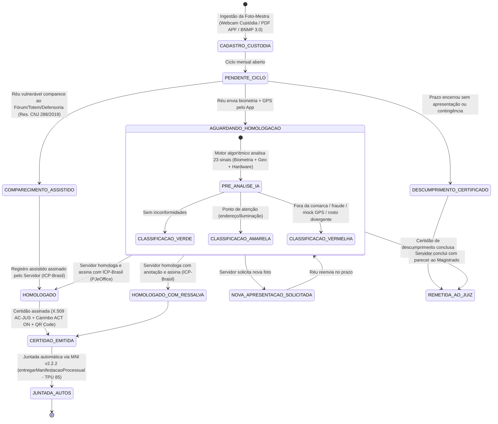

# Regras de Negócio, Cadastro na Custódia e Matriz de Riscos da IA • CompareceJus

Este documento detalha o ciclo de vida dos atos judiciais, as 3 formas oficiais de ingestão da Foto-Mestra (Base da Custódia), a matriz de 23 sinais pré-analíticos da Inteligência Artificial, a governança de homologação com assinatura ICP-Brasil e o protocolo de contingência para exclusão digital.

---

## 1. Ciclo de Vida da Apresentação (Máquina de Estados)

O sistema segue rigorosamente o princípio da supervisão humana obrigatória (**Human-in-the-Loop**), de modo que o processamento algorítmico da IA nunca gera decisão terminativa sem o crivo do servidor judiciário investido de fé pública.

---

## 2. Origem e Cadastro da Foto-Mestra (Base Biométrica da Custódia)

Um ponto crítico de segurança jurídica e operacional é garantir que a **Foto-Mestra (biometria de referência)** contra a qual os comparecimentos mensais serão confrontados tenha origem oficial, rastreável e imune a autofraude no primeiro acesso.

O CompareceJus implementa **3 formas complementares de ingestão da Foto-Mestra** (disponíveis na tela `/cadastro-custodia` e no endpoint `POST /api/cadastro-custodia`), permitindo que o servidor ou estagiário conclua o cadastro em **menos de 30 segundos** na própria sala de audiência:

| Modalidade de Ingestão | Código Técnico | Como Funciona na Prática | Fonte de Confiança |
|---|---|---|---|
| **1. Captura Direta na Sala de Audiência de Custódia** | `CAPTURA_DIRETA_AUDIENCIA_CUSTODIA` | Ao término da audiência que concede a liberdade provisória (art. 319, CPP), o servidor captura a foto do custodiado via webcam da sala de audiência (ou tablet institucional) em 5 segundos, já definindo o polígono territorial da comarca e o endereço declarado. | Presença física perante o Magistrado, MP, Defensoria e Servidor com fé pública. |
| **2. Extração da Foto do Auto de Prisão em Flagrante (APF)** | `EXTRACAO_PDF_APF` | Caso o réu já tenha se retirado ou a audiência ocorra por videoconferência, o servidor faz o upload/extração da fotografia oficial constante na peça do Auto de Prisão em Flagrante (APF) ou Boletim de Identificação Criminal juntado pela Polícia Judiciária nos autos do PJe/e-SAJ/eproc. | Documento público policial constante nos autos judiciais. |
| **3. Consulta ao Barramento BNMP 3.0 / TSE-ICN** | `BARRAMENTO_BNMP3_TSE` | Integração automatizada via CPF/RJI com o **Banco Nacional de Medidas Penais e Prisões (BNMP 3.0 / CNJ)**, com o módulo de Identificação Civil do programa *Fazendo Justiça* (CNJ/PNUD) ou com a Base da Identificação Civil Nacional (**TSE-ICN / Senatran**), importando o template facial oficial sem necessidade de nova captura. | Bases biométricas governamentais federais e judiciárias. |

---

## 3. A Matriz de Sinais do Motor de Pré-Análise da IA (23 Regras Auditáveis)

A IA do Tribunal (`src/analise-ia.js`) analisa a telemetria recebida através de um conjunto determinístico e explicável de regras heurísticas, biométricas e de integridade de hardware, com pontuação aditiva de risco (0 a 100):

| Código do Sinal | Categoria | Descrição da Verificação | Nível de Risco | Peso |
|---|---|---|:---:|:---:|
| `FORA_DA_COMARCA` | Territorial | Coordenadas fora do raio fixado para a Comarca autorizada pelo Juízo (Art. 319, IV, CPP). | **ALTO** | 40 |
| `BIOMETRIA_DIVERGENTE` | Identidade | Distância euclidiana do descritor facial > 0.55 em relação à Foto-Mestra da custódia. | **ALTO** | 40 |
| `LIVENESS_FALHOU` | Antifraude | Falha na prova de vida ativa (desafios dinâmicos de piscar os olhos / rotação). | **ALTO** | 40 |
| `ROSTO_AUSENTE` | Qualidade | Nenhum rosto humano detectado no enquadramento. | **ALTO** | 40 |
| `MULTIPLOS_ROSTOS` | Antifraude | Mais de uma face detectada no enquadramento da selfie. | **ALTO** | 40 |
| `FOTO_REUTILIZADA` | Antifraude | Hash SHA-256 da imagem idêntico a envio anterior (foto estática ou replay). | **ALTO** | 40 |
| `DISPOSITIVO_COMPARTILHADO` | Antifraude | Mesmo identificador de hardware utilizado para réus distintos. | **ALTO** | 40 |
| `DESLOCAMENTO_IMPOSSIVEL` | Territorial | Velocidade implícita entre apresentações > 900 km/h (teletransporte / spoofing). | **ALTO** | 40 |
| `AUTOMACAO_DETECTADA` | Antifraude | Sinalizador de controle por robô/webdriver ativo no navegador (`navigator.webdriver`). | **ALTO** | 40 |
| `EMULADOR_OU_AMBIENTE_VIRTUAL` | Hardware | Detecção de User-Agent/GPU de emulador Android/iOS ou máquina virtual (BlueStacks, Genymotion, Nox, SwiftShader). | **ALTO** | 40 |
| `CAMERA_VIRTUAL_DETECTADA` | Hardware | Detecção de driver de injeção de vídeo ou câmera virtual (OBS Virtual Camera, ManyCam, DroidCam, Iriun). | **ALTO** | 40 |
| `MOCK_LOCATION_ATIVO` | Hardware / Geo | Flag de localização simulada (`isFromMockProvider` / `mocked`) reportada pela API de telemetria do dispositivo. | **ALTO** | 40 |
| `LONGE_DO_ENDERECO` | Territorial | Dentro da comarca, porém a mais de 1.000m do endereço residencial declarado na custódia. | **MÉDIO** | 15 |
| `BIOMETRIA_INCONCLUSIVA` | Identidade | Distância facial entre 0.45 e 0.55 (iluminação atípica, câmera de baixa resolução ou adereços). | **MÉDIO** | 15 |
| `GPS_IMPRECISO` | Territorial | Margem de erro reportada pelo GPS superior a 300 metros. | **MÉDIO** | 15 |
| `GPS_PRECISAO_IRREAL` | Antifraude | Margem de erro < 1 metro (padrão típico de injeção estática de coordenadas). | **MÉDIO** | 15 |
| `TELEMETRIA_GPS_SINTETICA` | Hardware / Geo | Coordenadas com casas decimais truncadas/exatas (ausência de entropia natural de satélites GNSS). | **MÉDIO** | 15 |
| `WEBVIEW_NAO_HOMOLOGADA` | Hardware | Acesso originado de WebView embutida modificada ou container não homologado. | **MÉDIO** | 15 |
| `GPS_DESATUALIZADO` | Territorial | Leitura de coordenadas em cache com mais de 2 minutos de idade. | **MÉDIO** | 15 |
| `BIOMETRIA_NAO_PROCESSADA` | Contingência | Modelo neural indisponível no cliente; requer conferência visual humana. | **MÉDIO** | 15 |
| `FORA_DO_PRAZO` | Temporal | Envio efetuado fora da janela mensal autorizada. | **BAIXO** | 5 |
| `RELOGIO_DIVERGENTE` | Temporal | Horário do dispositivo diverge mais de 10 min do fuso oficial de Brasília. | **BAIXO** | 5 |
| `MUITAS_TENTATIVAS` | Usabilidade | Mais de 3 tentativas de captura consecutivas antes do envio. | **BAIXO** | 5 |

### Critério de Classificação Final
* 🔴 **VERMELHO:** Presença de **ao menos 1 sinal ALTO**. Ação: Bloqueio de homologação em lote; auditoria humana obrigatória; sugestão de remessa dos autos conclusos ao Juiz de Direito.
* 🟡 **AMARELO:** Ausência de sinal ALTO, mas presença de **ao menos 1 sinal MÉDIO**. Ação: Conferência visual pelo escrevente antes de homologar e assinar.
* 🟢 **VERDE:** Somente sinais BAIXOS ou ausência total de inconformidades. Ação: Habilitado para **Homologação e Assinatura Digital ICP-Brasil em Lote (1 clique)** com juntada automática via MNI.

---

## 4. Diretrizes de Acessibilidade e Não-Exclusão Digital (Resolução CNJ nº 288/2019)

Em estrita observância à **Resolução CNJ nº 288/2019** (Política Institucional do Poder Judiciário para a promoção da aplicação de alternativas penais, com enfoque restaurativo, em substituição à privação de liberdade) e aos princípios constitucionais da dignidade da pessoa humana e do amplo acesso à Justiça:

### 4.1 Proibição de Penalização por Hipossuficiência ou Falha Tecnológica
1. **Natureza Desoneradora do Aplicativo:** O CompareceJus é um instrumento de facilitação do cumprimento da medida cautelar e de eficiência cartorária, **jamais um requisito econômico excludente**.
2. **Vedação à Revogação Automática:** Nenhum réu pode sofrer revogação de liberdade provisória ou decretação de prisão preventiva em decorrência de:
   - Não possuir aparelho smartphone compatível;
   - Ausência de pacote de dados móveis ou internet residencial;
   - Furto, roubo, extravio, quebra de câmera ou esgotamento de bateria do aparelho;
   - Dificuldades cognitivas, idade avançada, deficiência visual/motora ou baixo letramento digital.

### 4.2 Canais Alternativos Físicos e Registro Assistido no Sistema
Para garantir que 100% dos comparecimentos — inclusive os presenciais — gerem certidão eletrônica padronizada e juntada automática via MNI (extinguindo em definitivo o livro de papel), o painel da secretaria (`tela4_painel_servidor.html`, endpoint `POST /api/servidor/comparecimento-assistido`) dispõe do módulo **"Registrar Comparecimento Assistido / Presencial no Fórum"**, operando em 4 canais físicos:
1. **Balcão da Secretaria Judicial (Atendimento Rápido):** O servidor seleciona o réu, confere seu documento oficial com a Foto-Mestra da tela e clica em *"Homologar, Assinar (ICP-Brasil) e Juntar"*, emitindo recibo impresso ou por SMS/WhatsApp institucional em 15 segundos.
2. **Totem de Autoatendimento no Átrio do Fórum:** Terminal com câmera e conectividade interna do Tribunal disponível na entrada do Fórum para cidadãos sem celular próprio.
3. **Posto da Defensoria Pública:** Registro assistido realizado por servidores ou estagiários da Defensoria Pública conveniada.
4. **Central Integrada de Alternativas Penais (CIAP / CAP):** Registro conjunto durante o acompanhamento psicossocial periódico.

### 4.3 Protocolo de Tolerância Operacional
* Caso o réu tente realizar a apresentação pelo celular e enfrente falha técnica recorrente de biometria ou conexão, a tentativa fica registrada na trilha de auditoria como **Comparecimento Tempestivo em Contingência**, concedendo prazo suplementar de **5 (cinco) dias úteis** para complementação remota ou comparecimento assistido sem configuração de inadimplemento cautelar.

---

## 5. Regras de Competência e Periodicidade

1. **Janela Regular:** Aberta do 1º ao último dia do mês corrente (fuso horário oficial `America/Sao_Paulo`).
2. **Unicidade do Ato:** O réu realiza 1 apresentação por mês de competência. Novas tentativas são bloqueadas, salvo se o cartório emitir despacho solicitando reenvio (`NOVA_APRESENTACAO_SOLICITADA`).
3. **Módulo de Justificativa Judicial:** O réu impossibilitado de comparecer (por internação, doença ou trabalho) protocola justificativa pelo app com anexo comprobatório, gerando protocolo `JUST-AAAA-NNNNNN-D` para análise da secretaria.
4. **Fechamento Automático de Ciclo (Gestão de Descumprimento):** No 1º dia útil subsequente, o sistema lista apenas os réus que não se apresentaram pelo app, não realizaram comparecimento assistido no Fórum e não protocolaram justificativa tempestiva, gerando minuta de Certidão de Descumprimento para apreciação do Magistrado (Art. 312, parágrafo único, do CPP).
