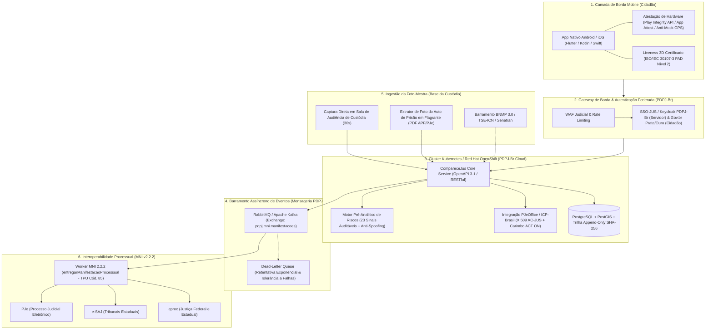
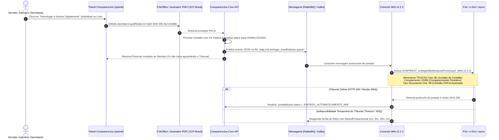

# Arquitetura Alvo para Produção • Ecossistema PDPJ-Br (Módulo Cautelar)

Este documento descreve a topologia técnica, a governança de segurança e os padrões de interoperabilidade do **CompareceJus (v2.0)** desenhado estritamente como um **microsserviço nativo da Plataforma Digital do Poder Judiciário Brasileiro (PDPJ-Br — Resolução CNJ nº 335/2020)**.

---

## 1. Topologia da Solução Integrada à Nuvem PDPJ-Br

---

## 2. Estratégia de Segurança de Borda Mobile: Play Integrity API (Android) e App Attest / DeviceCheck (iOS)

> [!IMPORTANT]
> **Distinção Formal entre Protótipo Web e Aplicativo Homologado de Produção:**
> A versão web executada em navegador mobile neste repositório constitui um **protótipo conceitual e funcional de demonstração** para avaliação de fluxo negocial pelo CNJ (DMF e DTI). Navegadores web convencionais possuem isolamento em *sandbox* que impede a inspeção profunda de *kernel* contra aplicativos de GPS falso (*Mock Location* a nível de sistema) ou drivers de câmera virtual emulada.
> Por essa razão, **o aplicativo final homologado para distribuição oficial aos réus opera obrigatoriamente em camada nativa sob atestação criptográfica de integridade de hardware**.

### 2.1 Camada de Atestação Criptográfica de Hardware
1. **Google Play Integrity API (Android):**
   - Antes de abrir a câmera ou coletar o GPS, o backend do CompareceJus gera um `nonce` criptográfico único e solicita o veredito assinado pelos servidores do Google Play Services:
     - `MEETS_STRONG_INTEGRITY`: Garante que o aplicativo roda em dispositivo Android físico genuíno, com *bootloader* bloqueado, sem *root* (Magisk/Xposed) e com sistema operacional certificado por hardware (*Hardware-backed Keystore / StrongBox*).
     - `appLicensingVerdict`: Impede a execução de APKs modificados ou recompilados fora da assinatura oficial do CNJ.
2. **Apple App Attest & DeviceCheck (iOS):**
   - Utiliza o *Secure Enclave* dos dispositivos Apple para gerar chaves criptográficas vinculadas ao hardware, atestando que o binário do CompareceJus não sofreu *jailbreak*, *hooking* (Frida/Cydia) ou interceptação de chamadas de localização (`CLLocationManager`).
3. **Blindagem Anti-Fake GPS e Telemetria de Sensores:**
   - **No App Nativo:** Verificação nativa de `Location.isFromMockProvider()` (Android API 18+) e `Location.isMock()` (Android API 31+), cruzada com fusão de sensores inerciais (acelerômetro/giroscópio), efemérides de satélites GNSS (SNR/CN0) e triangulação de torres celulares/BSSID Wi-Fi.
   - **No Motor Pré-Analítico (`src/analise-ia.js`):** Mesmo no protótipo, o motor de IA já implementa regras específicas de integridade de telemetria (`MOCK_LOCATION_ATIVO`, `TELEMETRIA_GPS_SINTETICA`, `EMULADOR_OU_AMBIENTE_VIRTUAL`, `CAMERA_VIRTUAL_DETECTADA` e `WEBVIEW_NAO_HOMOLOGADA`), bloqueando homologação automática caso detecte indícios de virtualização, câmera OBS/ManyCam ou coordenadas com entropia decimal artificial.
4. **Liveness 3D Certificado (ISO/IEC 30107-3):**
   - Proteção contra ataques de apresentação (*Presentation Attack Detection - PAD* Nível 2) para barrar fotos impressas, reprodução em telas OLED/4K, máscaras 3D e injeção de vídeo em nível de driver.

---

## 3. Fluxo Assíncrono de Juntada Automática nos Autos via Mensageria e MNI v2.2.2

Para eliminar 100% do trabalho manual do servidor de baixar PDFs e realizar upload no sistema processual, a homologação dispara um pipeline assíncrono resiliente:

### Especificação Técnica do Payload MNI v2.2.2 (`src/integracao-mni.js`)
* **Operação Padrão CNJ:** `ser:entregarManifestacaoProcessual` (WSDL Intercomunicação v2.2.2).
* **Tabelas Processuais Unificadas (TPU/CNJ — Resolução CNJ nº 46/2007):**
  - **Movimento Processual:** Código `85` (*Juntada de Certidão*) combinado com complemento tabelado `12266` (*Comparecimento Periódico em Juízo / Medida Cautelar Diversa da Prisão*).
  - **Tipo de Documento:** Código `58` (*Certidão Judicial*), encapsulado em `application/pdf` (padrão PDF/A-1b) com assinatura destacada ou embutida (`PKCS#7 / CADES-T`) e manifesto JSON de auditoria.
* **Desacoplamento por Mensageria (RabbitMQ / Kafka):**
  - Tribunais estaduais e federais sofrem janelas de manutenção e oscilações de latência. O uso da *exchange* `pdpj.mni.manifestacoes.exchange` garante que a homologação em lote de centenas de processos pelo escrevente ocorra em milissegundos na interface, enquanto os *workers* realizam a entrega garantida (*At-Least-Once Delivery*) com controle de idempotência (`idempotencyKey`) e fila *Dead-Letter (DLQ)*.

---

## 4. Assinatura Digital Qualificada com Fé Pública (PJeOffice / ICP-Brasil)

Em estrita observância ao **art. 1º, § 2º, III, e art. 11 da Lei nº 11.419/2006 (Lei do Processo Judicial Eletrônico)** e à **MP nº 2.200-2/2001**:

1. **Integração com PJeOffice Pro / Assinador Digital PDPJ-Br:**
   - Tanto na homologação individual quanto na homologação em lote, a certidão recebe assinatura digital qualificada vinculada ao certificado **ICP-Brasil (A1/A3 emitido pela AC-JUS)** do servidor autenticante.
2. **Metadados Criptográficos Auditáveis:**
   - **Cadeia de Certificação:** `Autoridade Certificadora Raiz Brasileira v10 -> AC-JUS v5 -> AC-JUS Certificadora Judicial`.
   - **Carimbo do Tempo (RFC 3161):** Sincronizado com Autoridade de Carimbo do Tempo (ACT) oficial ligada ao **Observatório Nacional (ON)**.
   - **Verificação Pública (`verificar.html`):** Qualquer magistrado, promotor, defensor ou cidadão que escanear o QR Code da certidão visualiza o selo oficial:
     > *"Documento assinado digitalmente por [Nome do Servidor] ([Matrícula]) com certificado ICP-Brasil"*, acompanhado do serial X.509, hash SHA-256 do documento assinado e protocolo de juntada MNI v2.2.2.

---

## 5. Alinhamento Arquitetural com a Nuvem PDPJ-Br (Kubernetes / OpenShift, SSO-JUS e OpenAPI)

O repositório já inclui containerização pronta na raiz ([`Dockerfile`](../Dockerfile) e [`docker-compose.yml`](../docker-compose.yml)) seguindo os requisitos técnicos da Diretoria de Tecnologia da Informação (DTI/CNJ) para publicação no **Marketplace da PDPJ-Br**:

### 5.1 Topologia Kubernetes / Red Hat OpenShift
* **Containers Non-Root (OpenShift Restricted SCC):** O [`Dockerfile`](../Dockerfile) é construído sobre `node:22-alpine`, configurado com permissões de grupo GID `0` e execução sob UID não-privilegiado (`USER 1001`), atendendo às *Security Context Constraints (SCC)* restritas do Red Hat OpenShift utilizado pelo CNJ e pelos Tribunais.
* **Probes de Orquestração:** Endpoint nativo `/api/info` configurado para `livenessProbe` e `readinessProbe`, permitindo escalonamento horizontal automático (*Horizontal Pod Autoscaler - HPA*).
* **Stateless Application Tier:** Todo estado em produção é externalizado para banco relacional gerenciado (PostgreSQL HA) e Object Storage S3-compatible (MinIO/Ceph institucional para artefatos biométricos criptografados).

### 5.2 Autenticação e Autorização Unificada (SSO-JUS / Keycloak)
* **Servidores e Magistrados:** Integração nativa via **OpenID Connect (OIDC) / OAuth 2.0** com o broker **Keycloak da PDPJ-Br (`sso.cloud.pdpj.jus.br`)**, mapeando *claims* de lotação (`orgaoJulgador`, `comarca`, `cargo`, `matricula`) diretamente no controle de acesso baseado em papéis (RBAC).
* **Cidadãos Submetidos a Medidas Cautelares:** Integração com o **Login Único Gov.br** (níveis Prata e Ouro — validação biométrica facial junto à base da Senatran/TSE), complementada pelo vínculo processual registrado na Audiência de Custódia.

### 5.3 Padrão de APIs RESTful sob OpenAPI 3.1 / Swagger
Todos os serviços do microsserviço seguem arquitetura RESTful documentada sob especificação OpenAPI, com comunicação JSON padronizada e publicação de eventos no barramento negocial da PDPJ-Br:

| Método | Endpoint | Escopo / Papel | Descrição Funcional |
|---|---|---|---|
| `GET` | `/api/info` | Público / K8s Probe | Healthcheck e metadados de versão da instância na nuvem PDPJ-Br. |
| `POST` | `/api/cadastro-custodia` | Servidor (Custódia) | Registra o réu em 30s na sala de custódia com Foto-Mestra (Webcam/APF/BNMP 3.0) e polígono territorial. |
| `POST` | `/api/apresentacoes` | Cidadão (App) | Recebe biometria facial, telemetria GPS anti-mock e executa pré-análise da IA (23 regras). |
| `POST` | `/api/servidor/homologar` | Servidor (ICP-Brasil) | Homologa individualmente, assina com certificado ICP-Brasil e dispara juntada MNI v2.2.2. |
| `POST` | `/api/servidor/homologar-lote` | Servidor (ICP-Brasil) | Homologa em lote os casos verdes, assina digitalmente e enfileira juntada MNI assíncrona. |
| `POST` | `/api/servidor/comparecimento-assistido` | Servidor / Balcão | Registra comparecimento presencial assistido (Res. CNJ 288/2019 — hipossuficiência/exclusão digital). |
| `GET` | `/api/public/verificar` | Público (QR Code) | Valida autenticidade da certidão, assinatura ICP-Brasil e protocolo de juntada MNI. |

---

## 6. Plano de Implantação Gradual (Roadmap Proposto)

| Fase | Duração | Escopo Principal | Critérios de Sucesso |
|---|:---:|---|---|
| **Fase 1: Projeto Piloto em Vara Única** | 90 dias | Implantação em 1 Vara Criminal ou Central de Alternativas Penais com adesão de réus em liberdade provisória. | > 85% de comparecimento digital regular; redução de 90% das filas de assinatura em livro físico. |
| **Fase 2: Expansão Estadual via MNI** | 180 dias | Ativação do conector MNI v2.2.2 com PJe/e-SAJ/eproc e assinatura PJeOffice em todas as Varas Criminais do TJ piloto. | Homologação e juntada 100% automatizadas; tempo médio de homologação < 2 horas úteis. |
| **Fase 3: Módulo Cautelar Nacional PDPJ-Br** | Contínua | Publicação oficial no catálogo da PDPJ-Br como extensão cautelar integrada ao ecossistema SAREF/BNMP 3.0. | Padronização nacional do cumprimento eletrônico das medidas cautelares do art. 319 do CPP. |
