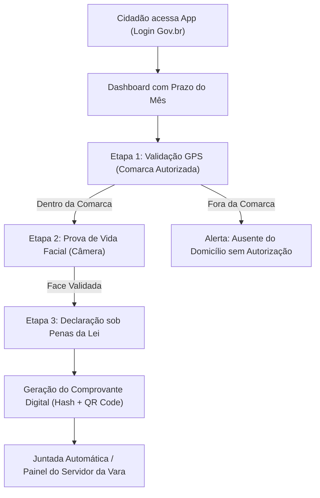

# Plano de Implementação: App de Comparecimento Mensal em Juízo (Medida Cautelar)

## Goal Description
O objetivo deste projeto é construir um protótipo funcional e de alto impacto visual do aplicativo **CompareceJus** (nome de projeto sugerido), voltado para a comprovação periódica (mensal) de cumprimento de **Medidas Cautelares Diversas da Prisão (Art. 319, I, do Código de Processo Penal - CPP)**, Livramento Condicional (LEP) e Acordos de Não Persecução Penal (ANPP).

Atualmente, cidadãos precisam se deslocar fisicamente todos os meses aos fóruns criminais apenas para assinar um livro ou folha de presença, gerando:
1. **Sobrecarga operacional nos fóruns:** Filas extensas nas secretarias de varas e balcões, demandando tempo contínuo de servidores públicos para autenticação manual.
2. **Custo social e econômico:** Cidadãos perdem dias úteis de trabalho e gastam com transporte público recorrente, penalizando populações vulneráveis.
3. **Riscos de aglomeração e segurança pública:** Concentração desnecessária de fluxo nas dependências do Judiciário.

A solução proposta transfere essa verificação para o meio digital por meio de um aplicativo móvel no padrão **GOV.BR**, realizando a validação de presença através de **Geolocalização (Geofencing de Comarca)**, **Reconhecimento Facial com Prova de Vida Ativa (Liveness Detection)** e emissão de **Comprovante Digital Criptográfico com QR Code**. Além disso, o projeto inclui uma visão simples do **Painel do Servidor do Fórum**, permitindo que o irmão do usuário apresente uma solução ponta a ponta pronta para validação institucional no Tribunal de Justiça.

---

## User Review Required

> [!IMPORTANT]
> **Stitch MCP já está conectado e funcional!**
> Verificamos que o MCP do Stitch já está configurado no seu ambiente. Podemos tanto **gerar telas no Stitch automaticamente** quanto construir o protótipo web interativo executável (React + Vite + Tailwind + PWA) que você e seu irmão poderão abrir no computador ou no próprio celular para apresentar a diretores de vara e juízes.

> [!NOTE]
> **Conformidade Legal & LGPD (Pontos de Atenção para Apresentação ao Judiciário):**
> 1. **Não é rastreamento contínuo 24h:** O GPS só é ativado com consentimento estrito durante os 60 segundos do ato de comparecimento, evitando questionamentos sobre invasão de privacidade de pessoas sem tornozeleira eletrônica.
> 2. **Validação Cruzada:** Para a versão de produção, o sistema prevê integração com as bases biometrizadas oficiais (TSE / Gov.br / Polícia Civil / SEEU-CNJ). No protótipo, criaremos a experiência simulada com câmera real e fallback guiado.

---

## Open Questions

1. **Geração de Telas no Stitch vs Protótipo Interativo Web:**
   - Deseja que criemos um novo projeto diretamente no Stitch via MCP para gerar as telas mobile, OU prefere focar prioritariamente no protótipo web executável em React com frame de celular (que permite clicar, abrir a câmera real do computador/celular e testar o fluxo completo), OU **ambos**?
2. **Nome Institucional do Aplicativo:**
   - Sugerimos **"CompareceJus"** ou **"Gov.br | Comparecimento em Juízo"** ou **"Justiça Presente"**. Há alguma preferência ou sugestão de nome pelo seu irmão?
3. **Comarca Padrão para Simulação:**
   - No protótipo, podemos deixar pré-configurada a comarca onde vocês residem ou atuam (ex: São Paulo, Rio de Janeiro, Brasília, Belo Horizonte, etc.) para tornar a demonstração hiper-realista.

---

## Proposed Changes

### 1. Sistema de Design & Especificação GOV.BR (`DESIGN.md` e Prompts Stitch)
Estruturação da identidade visual com base no **Design System oficial do Governo Federal (DS Gov.br)**:
- **Cores Oficiais:**
  - Primária: `#0c326f` (Azul escuro institucional)
  - Interativa / Ação: `#1351b4` (Azul clássico Gov.br)
  - Destaques / Acento: `#ffcd07` (Amarelo ouro) e `#168821` (Verde bandeira)
  - Superfícies e Cards: `#ffffff` e `#f8f9fa`
  - Estados de Erro / Alerta: `#e52207` (Vermelho) e `#e6a100` (Âmbar)
- **Tipografia:** Rawline / Inter / Sans-serif moderna com legibilidade em telas móveis.
- **Componentes Gov.br:** Header padrão `gov.br`, barra de identificação do órgão ("Tribunal de Justiça - Vara de Execuções Penais"), cartões informativos com status em badge colorido, botão padrão Gov.br com raio de 4px a 8px.

---

### 2. Protótipo Interativo Frontend (React + Vite + Tailwind CSS)

O protótipo será construído em `c:\Users\TOTEM\Documents\antigravity\eager-turing` com uma arquitetura moderna, responsiva e pronta para demonstração:

#### [NEW] `package.json`
Configuração do projeto com React 19 / 18, Vite, Tailwind CSS v4 / v3, Lucide Icons, Canvas Confetti para celebração de conclusão e gerador de QR Code / PDF.

#### [NEW] `src/App.tsx`
Orquestrador central de navegação entre o modo **Aplicativo do Cidadão (Mobile Frame)** e o **Painel Administrativo do Servidor (Desktop/Web)**.

#### [NEW] `src/components/govbr/HeaderGovBr.tsx`
Barra superior oficial com logotipo `gov.br`, botão de acessibilidade e identificação do órgão do Poder Judiciário.

#### [NEW] `src/screens/citizen/LoginScreen.tsx`
Tela de acesso com CPF e credenciais do Gov.br (simulação com níveis Prata/Ouro exigidos para atos judiciais).

#### [NEW] `src/screens/citizen/DashboardScreen.tsx`
Tela principal do cidadão:
- Número do processo e vara de origem (ex: `0012345-67.2026.8.26.0100 - 1ª Vara de Execuções Penais`).
- Status do mês vigente: Card destacado com badge de prazo (ex: "Outubro/2026: Comparecimento Aberto - Prazo até 31/10").
- Botão primário Gov.br: "Iniciar Comparecimento Mensal".
- Histórico resumido de meses anteriores (Setembro: Cumprido, Agosto: Cumprido).
- Atalho para justificativa de impossibilidade de comparecimento (upload de atestado).

#### [NEW] `src/screens/citizen/LocationStepScreen.tsx`
Validação de Geolocalização (Geofencing):
- Leitura do GPS do dispositivo via API do navegador (`navigator.geolocation`).
- Simulação de comarca autorizada (com opção de alternar entre "Dentro da Comarca" e "Fora da Comarca" para teste de demonstração).
- Mapa interativo/ilustrativo mostrando o perímetro e o ponto do cidadão.

#### [NEW] `src/screens/citizen/BiometryStepScreen.tsx`
Validação Facial e Prova de Vida (Liveness Detection):
- Acesso à câmera frontal via `navigator.mediaDevices.getUserMedia` (com fallback para upload ou câmera simulada se o dispositivo não possuir câmera).
- Máscara oval de enquadramento facial.
- Desafio interativo de vivacidade: "Olhe para a câmera", "Pisque os olhos", "Mantenha a posição".
- Captura de foto e geração de hash biométrico de verificação.

#### [NEW] `src/screens/citizen/DeclarationStepScreen.tsx`
Termo de Declaração de Permanência:
- Texto formal declarando residência e cumprimento das obrigações sob o Art. 299 do Código Penal (Falsidade Ideológica).
- Botão "Assinar Digitalmente e Concluir".

#### [NEW] `src/screens/citizen/ReceiptScreen.tsx`
Comprovante Digital Oficial de Comparecimento:
- QR Code dinâmico para validação externa por policiais ou oficiais de justiça.
- Código Hash SHA-256 e Carimbo de Tempo com fuso horário de Brasília.
- Botão para exportar/imprimir o comprovante em PDF.

#### [NEW] `src/screens/citizen/JustificationScreen.tsx`
Tela para envio de justificativa formal em caso de impedimento (doença, internação, viagem a trabalho autorizada prévia).

#### [NEW] `src/screens/court/CourtDashboardScreen.tsx`
Painel do Servidor Público (Fórum / Vara Criminal):
- Métricas da Vara: Total de intimados do mês, comparecimentos validados, pendências e alertas de inconsistência.
- Tabela de cidadãos com busca por CPF/Nome.
- Visualização detalhada da prova de comparecimento (foto capturada, endereço GPS registrado, data e hora).
- Botão "Emitir Certidão de Cumprimento para o PJe/SEEU".

---

### 3. Prompts Otimizados para o Stitch (Gerador de UI)

Criaremos um arquivo com os prompts exatos prontos para geração no Stitch MCP, cobrindo:
1. `Prompt 1 - Citizen Mobile App (Gov.br Theme)`
2. `Prompt 2 - Liveness & Geolocation Verification Flow`
3. `Prompt 3 - Official Digital Receipt with QR Code`
4. `Prompt 4 - Court Clerk Back-Office Dashboard`

---

### 4. Dossiê de Apresentação Executiva (Pitch para o Judiciário)

Documento estruturado em markdown (`pitch_institucional.md`) com:
- **Resumo Executivo** para Juízes Corregedores e Diretores de Secretaria.
- **Fundamentação Jurídica** detalhada (CPP art. 319, Resoluções do CNJ, Programa Fazendo Justiça).
- **Análise de Custos e Economia Pública** (horas de servidores economizadas, redução de custos de atendimento).
- **Arquitetura de Segurança da Informação** (criptografia, auditoria, anti-mocking, LGPD).

---

## Verification Plan

### Automated Tests
1. `npm run build`: Garantir que a compilação do TypeScript e Vite ocorra sem erros.
2. `npm run lint`: Validação de sintaxe e padrões de código.

### Manual Verification
1. **Fluxo do Cidadão:**
   - Iniciar o servidor local (`npm run dev`) e abrir a URL no navegador (com visualização móvel responsiva).
   - Realizar login simulado Gov.br.
   - Navegar até o início do comparecimento mensal.
   - Testar a verificação de localização (permitir GPS ou alternar botão de teste de comarca).
   - Testar a prova de vida com ativação da câmera frontal.
   - Confirmar a declaração e verificar a emissão do Comprovante Digital com QR Code legível.
2. **Fluxo do Servidor Público:**
   - Alternar para o "Painel da Vara".
   - Conferir se o comparecimento recém-realizado aparece imediatamente na lista como "Validado com Sucesso".
   - Abrir a ficha do cidadão e verificar os dados de auditoria (foto, coordenadas, hash).
3. **Geração no Stitch:**
   - Executar chamada do Stitch MCP com o prompt refinado para geração de telas complementares no workspace Stitch.
